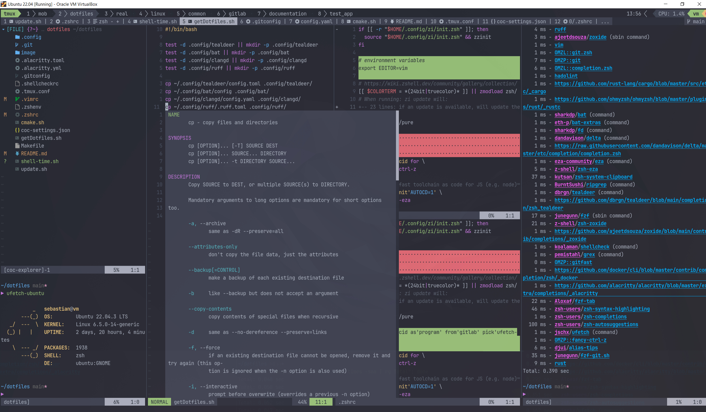

# dotfiles

My Linux dotfiles.

# TODO

https://github.com/AnthonyCalandra/modern-cpp-features
https://www.modernescpp.com/index.php/blog/
https://google.github.io/styleguide/cppguide.html
https://github.com/cpp-best-practices/cppbestpractices
https://isocpp.org/wiki/faq
https://isocpp.github.io/CppCoreGuidelines/CppCoreGuidelines
https://learn.microsoft.com/en-us/cpp/cpp/?view=msvc-160
https://www.cppstories.com/2018/08/init-string-member/
https://clang.llvm.org/extra/clang-tidy/checks/list.html
https://stackoverflow.com/questions/388242/the-definitive-c-book-guide-and-list
https://cpppatterns.com/
https://gcc.gnu.org/onlinedocs/gcc/Warning-Options.html
https://linux.die.net/man/1/gcc
https://github.com/isocpp/CppCoreGuidelines/blob/master/CppCoreGuidelines.md
https://stackoverflow.com/questions/5088460/flags-to-enable-thorough-and-verbose-g-warnings/9862800#9862800
https://clang.llvm.org/docs/DiagnosticsReference.html
https://code-examples.net/en/tagged/c++?sort=votes
https://en.wikibooks.org/wiki/More_C%2B%2B_Idioms
https://llvm.org/docs/CodingStandards.html
https://cpp-optimizations.netlify.app/
https://brevzin.github.io/
https://github.com/lmapii/run-clang-tidy
https://github.com/lmapii/run-clang-format
https://github.com/microsoft/GSL
https://github.com/rturrado/the_modern_cpp_challenge
https://embeddedartistry.com/fieldatlas/design-pattern-catalogue/
https://developers.redhat.com/articles/2021/10/13/printf-style-debugging-using-gdb-part-2
https://developers.redhat.com/articles/2021/10/05/printf-style-debugging-using-gdb-part-1#
https://clang.llvm.org/docs/ClangFormatStyleOptions.html
https://www.w3computing.com/articles/programming-languages/cplusplus/#gsc.tab=0
https://github.com/lefticus/cpp_weekly/issues/175
https://github.com/cpp-best-practices/cmake_template
https://github.com/google/fuzzing
https://github.com/cpp-best-practices/cmake_template/blob/main/cmake/CompilerWarnings.cmake
https://github.com/intel/cicd-repo-infrastructure
https://github.com/HappyCerberus/daily-bite-cpp
https://www.youtube.com/playlist?list=PLvv0ScY6vfd8j-tlhYVPYgiIyXduu6m-L
https://sourceware.org/gdb/current/onlinedocs/gdb.html/index.html#SEC_Contents
https://tamara-schmitz-devel.de/posts/gdb-reference/

```bash
▶ zsh-bench
==> benchmarking login shell of user meinzer1899...
creates_tty=0
has_compsys=0
has_syntax_highlighting=0
has_autosuggestions=0
has_git_prompt=0
first_prompt_lag_ms=26.536
first_command_lag_ms=115.626
command_lag_ms=2.363
input_lag_ms=4.038
exit_time_ms=101.818
```

Is this fast? From https://github.com/romkatv/zsh-bench#how-fast-is-fast

| latency (ms)          | the maximum value indistinguishable from zero |
|-----------------------|----------------------------------------------:|
| **first prompt lag**  |                                            50 |
| **first command lag** |                                           150 |
| **command lag**       |                                            10 |
| **input lag**         |                                            20 |

Although showing `0` for `has_syntax_highlighting`, `has_git_prompt`, `has_autosuggestions`, `has_compsys`,
these are enabled.



# Setup new machine

1. Install git and pull dotfiles repository
1. Setup WSL
1. `mkdir -p $HOME/.config` (otherwise, `.config` is a symlink to `$HOME/dotfiles/.config`).
1. Install zsh and zi
1. Install stow, run `cd dotfiles && stow .`
1. Install tmux

## pip

* difference `python pip install` vs `python -m pip install` https://stackoverflow.com/questions/25749621/whats-the-difference-between-pip-install-and-python-m-pip-install
* https://thelinuxcode.com/python-requirements-txt-file/

```bash
apt install python3.XX-venv # (e.g. 10)
```

Don't upgrade system to use other python version than that available in apt. Can cause other commands
(e.g. apt-get) to break.

## clipboard

```bash
apt install xclip
```

## Remap CAPSLOCK to ctrl

https://github.com/ian-howell/.dotfiles/blob/main/src/remap_capslock.sh
https://askubuntu.com/questions/33774/how-do-i-remap-the-caps-lock-and-ctrl-keys#comment1154797_521734
sudo vi /etc/default/keyboard and change XKBOPTIONS="ctrl:nocaps"
setxkbmap -option ctrl:nocaps

https://superuser.com/questions/949385/map-capslock-to-control-in-windows-10

## VirtualBox

Update GuestAdditions after updating VirtualBox via https://help.ubuntu.com/community/VirtualBox/GuestAdditions.
```bash
sudo apt-get install virtualbox-guest-additions-iso
```

## wsl

* Install nerd font
    * on Linux via curl https://github.com/ryanoasis/nerd-fonts?tab=readme-ov-file#option-1-release-archive-download.
    * on Windows via downloading zip archive and using Settings -> fonts (move font files into dotted square)
* Install alacritty for Windows.
* Move alacritty.wsl.toml to [`%APPDATA%\alacritty`](https://github.com/alacritty/alacritty?tab=readme-ov-file#configuration).
* map capslock to ctrl: https://superuser.com/questions/949385/map-capslock-to-control-in-windows-10.
* Alternatively, use [MS PowerToys](https://learn.microsoft.com/en-us/windows/powertoys/install#installing-with-microsoft-store) to map Ctrl-M as Enter as well. Cannot map Ctrl-J to down (Ctrl-K up, Ctrl-C Esc) because that conflicts with either Linux or Windows shortcuts. In MS PowerToys dashboard, deactivate all other modules that are not needed.
* notifications: https://github.com/Windos/BurntToast, call with       `notify-send() { powershell.exe -command New-BurntToastNotification "-Text '${@}'"; }`. Further reading https://stuartleeks.com/posts/wsl-github-cli-windows-notifications-part-1/ and https://github.com/microsoft/WSL/issues/2466.
* Kill WSL2 (e.g. does not respond): https://github.com/microsoft/WSL/issues/6982#issuecomment-1474994319
* Configuration: https://learn.microsoft.com/en-us/windows/wsl/wsl-config#user-settings

## zsh and zi

https://github.com/zsh-users/zsh/blob/master/INSTALL

`$ZPFX`: https://wiki.zshell.dev/docs/guides/customization#ZPFX

Install zsh to $HOME/.zi/polaris, where no sudo is needed.

```bash
mkdir -p $HOME/.zi/polaris
./configure --prefix=$HOME/.zi/polaris
```

zi loader is included in dotfiles (.config/zi)
Additional information https://wiki.zshell.dev/docs/getting_started/installation => loader.
Don't use other installation methods using curl, because of security issues (https://github.com/z-shell/wiki/issues/588).

### misc

* [Pressing "enter" on an empty buffer displays an information-rich and pretty dashboard.](https://github.com/chrisgrieser/zsh-magic-dashboard)
* https://registerspill.thorstenball.com/p/how-fast-is-your-shell
* https://github.com/unixorn/awesome-zsh-plugins

### zshrcs

* https://github.com/lljbash/dotfiles/blob/212623dd3f1693ef273bc0e5dce91693797f1a2f/zshrc#L1
* https://github.com/hlissner/dotfiles/blob/254aea2230e1350409a7ae7b6566bcd98f5b5360/config/zsh/completion.zsh#L1
* https://github.com/chrisgrieser/.config/tree/main/zsh/config
* https://github.com/lljbash/dotfiles/blob/master/zshrc
* https://github.com/bew/dotfiles/tree/main/zsh
* https://github.com/HaleTom/dotfiles/blob/main/zsh/.config/zsh/.zshrc
* https://github.com/mattmc3/zdotdir
* https://github.com/doronbehar/dotfiles/blob/master/.zshrc
* https://github.com/ctrueden/dotfiles/blob/main/zshrc
* https://github.com/itchyny/dotfiles/blob/main/.zshrc
* https://github.com/timtyrrell/dotfiles-chezmoi/blob/master/dot_zshrc
* https://github.com/Freed-Wu/Freed-Wu/blob/main/.zshrc
* https://github.com/kutsan/dotfiles/blob/master/.config/zsh/config/settings.zsh
* https://git.sr.ht/~seirdy/dotfiles/tree/master/.config/shell_common/zsh/zinit.zsh
* https://github.com/callistachang/dots/blob/main/dot_zshrc
* https://github.com/casey/dotfiles/blob/master/etc/zshrc
* https://github.com/agkozak/
* https://github.com/seagle0128/dotfiles/blob/master/.zshrc

## bash, shell

* [A full-featured BDD unit testing framework for bash, ksh, zsh, dash and all POSIX shells](https://github.com/shellspec/shellspec)
* [A collection of Bash scripts for creating safe and useful command line programs.](https://github.com/xwmx/bash-boilerplate)
* https://dwheeler.com/essays/filenames-in-shell.html 2025, Shell quoting,Filename splitting,NUL-delimited filenames,Leading-dash filenames,Shell globbing,find -print0 ,xargs -0
* https://www.golinuxcloud.com/linux-commands-cheat-sheet/
* [Easy, repeatable testing of CLI programs/commands](https://github.com/simonmichael/shelltestrunner)
* https://www.geeksforgeeks.org/linux-unix/shell-scripting-shell-variables/
* https://mywiki.wooledge.org/BashPitfalls
* https://mywiki.wooledge.org/BashPitfalls#set_-euo_pipefail recommends against `set -e` because of the various pitfalls especially in conditional evaluation and option `pipefail` and recommends own error handling instead.
* http://redsymbol.net/articles/unofficial-bash-strict-mode/ and http://redsymbol.net/articles/unofficial-bash-strict-mode/#short-circuiting
```bash
set -euo pipefail; shopt -s failglob # safe mode
```

To release resources, use bash exit traps. http://redsymbol.net/articles/bash-exit-traps/

* https://mywiki.wooledge.org/BashFAQ
* https://mywiki.wooledge.org/BashGuide
* https://mywiki.wooledge.org/BashPitfalls
* https://www.gnu.org/software/bash//manual/html_node/The-Shopt-Builtin.html
* https://quickref.me/bash
* https://devhints.io/bash

## git

* [Easy access to gitignore boilerplates from https://github.com/github/gitignore](https://github.com/simonwhitaker/gibo)
* [Reliable 'git bisect run' recipes in a few lines of Python.](https://github.com/martinus/git_bisectlib) with https://martin.ankerl.com/2026/07/08/broken-build-is-not-a-bad-commit/
* https://github.com/gitleaks/gitleaks Protect and discover secrets using Gitleaks 🔑
* https://github.com/stevearc/dotfiles/blob/master/.githelpers
* https://github.com/mathiasbynens/dotfiles/blob/main/.gitconfig

For Ubuntu, this PPA provides the latest stable upstream Git version: https://git-scm.com/download/linux.

Add .gitconfig.local for user private global entries
https://git-scm.com/docs/user-manual.html#telling-git-your-name

Add ssh key so that you can push to dotfiles repository with correct user.

In dotfiles repository, change local email to noreply email from Github (preferences, email)
https://docs.github.com/en/account-and-profile/setting-up-and-managing-your-personal-account-on-github/managing-email-preferences/setting-your-commit-email-address#setting-your-email-address-for-a-single-repository

ssh keys:
~/.ssh/config
specify, which key belongs to which host
(https://stackoverflow.com/a/69764024)

[🦎 Githooks: per-repo and shared Git hooks with version control and auto update.](https://github.com/gabyx/Githooks)
[interactive `git` with the help of `fzf`      ](https://github.com/bigH/git-fuzzy)
[Protect and discover secrets using Gitleaks 🔑      ](https://github.com/gitleaks/gitleaks)
[Command-line Git information tool](https://github.com/o2sh/onefetch)

## alacritty

https://github.com/alacritty/alacritty/blob/master/INSTALL.md
```bash
cargo build --release
```

Windows: download executable

## TMUX

https://github.com/tmux/tmux/wiki/Installing#from-version-control

```bash
sh autogen.sh
./configure
make -j$(nproc) && sudo make install
```

`tmux new -s tmux`

.tmux.conf:
* https://github.com/fenetikm/dotfiles/blob/master/.tmux.conf
* [Toggle-able Terminal in Tmux](https://gist.github.com/pbnj/67c16c37918ba40bbb233b97f3e38456)
* https://github.com/sunaku/home/blob/master/.tmux.conf.erb
* https://github.com/doronbehar/.tmux/tree/master
* https://gist.github.com/adibhanna/979461c5f7d906daf24925fbd9b255eb
* https://github.com/mrnugget/dotfiles/blob/master/tmux.conf

* [Tmux Popups - The Most Underrated Feature in Tmux. Cool sind: LLM, Musik player, interactive Python shell. numbat?](https://www.youtube.com/watch?v=7BP9iWiKx8Q)
* [Make tmux powerful and pretty 🥊💅](https://github.com/2KAbhishek/tmux2k)
* [Tmux AppImage build via Docker](https://github.com/nelsonenzo/tmux-appimage)

## cargo and rust

Search rust book via cli:

https://github.com/0xhiro/thebook

## fzf

To auto-accept entry on Enter when searching with CTRL-R, use `fzf-accept-on-enter.diff`
from https://github.com/junegunn/fzf/issues/477#issuecomment-444053054.

`git apply --stat --apply ~/dotfiles/fzf-accept-on-enter.diff`
`mv fzf-keybindings-new.zsh fzf-key-bindings.zsh`

* https://github.com/junegunn/fzf
* https://github.com/junegunn/fzf-git.sh

Vim Integration: https://github.com/junegunn/fzf/blob/master/README-VIM.md

* A very fast, portable and hackable fuzzy finder.(https://github.com/alexpasmantier/television/)

## docker

```bash
    # docker run not needed?
    docker run --detach -v $(pwd):$(pwd) -w $(pwd) --name <name> image:tag sleep infinity # may does not work, if ENTRYPOINT is set in Dockerfile
    docker start <name> # if container with that name already exists
    docker exec <name> command # execute command, e.g. via vim-dispatch
    docker exec -it <name> /bin/bash # attach interactively
    docker stop name # to stop
```

* [Docker image to compile C++ projects with recent Clang and GCC compilers](https://github.com/wichtounet/cpp)
https://stackoverflow.com/questions/45023363/what-is-docker-io-in-relation-to-docker-ce-and-docker-ee-now-called-mirantis-k
https://docs.docker.com/engine/install/ubuntu

* https://devopscube.com/reduce-docker-image-size/

* https://github.com/wagoodman/dive A tool for exploring each layer in a docker image
* https://github.com/wagoodman analyze image size, vulnerabilities and more
* https://github.com/kkvh/vim-docker-tools Toolkit for managing docker containers, networks and images in vim.

* https://github.com/philips-software/amp-devcontainer/tree/main/.devcontainer/cpp
* https://github.com/StableCoder/docker-build-core
* https://github.com/think-cell/docker
* https://github.com/foonathan/docker/tree/main
* https://docs.docker.com/develop/develop-images/dockerfile_best-practices/

## vim

* [My Vim-related gists](https://gist.github.com/romainl/4b9f139d2a8694612b924322de1025ce)
* [Compile Code The Way Vim Intended.](https://www.youtube.com/watch?v=vB3NT9QIXo8)
* https://swedishembedded.com/developers/vim-in-minutes
* https://vonheikemen.github.io/devlog/tools/how-to-survive-without-multiple-cursors-in-vim/
* https://hamvocke.com/blog/ansi-vim-color-scheme/ I prefer defining my terminal color scheme once and having command-line tools inherit it.
* [Vim Universe - Small videos 1:30 - 8:00 vim commands, tips and tricks](https://www.youtube.com/playlist?list=PLrU0uga7kmr0dsc3wWS4TS9mRX0Ue7kn)
* https://github.com/ibhagwan/vim-cheatsheet
* https://learnvimscriptthehardway.stevelosh.com/
* https://github.com/mattmc3/neovim-cheatsheet

* https://its.mw/tags/vim/
* https://www.youtube.com/playlist?list=PLrU0uga7kmr0dsc3wWS4TS9mRX0Ue7kn Vim Universe Playlist
* https://swedishembedded.com/developers/vim-in-minutes Awesome Vim: Modern Guide To A Fully Featured Vim IDE
* https://bluz71.github.io/2021/09/10/vim-tips-revisited.html
* https://vimtricks.com/p/category/tips-and-tricks/
* http://vimcasts.org/episodes/search-multiple-files-with-vimgrep/
* https://github.com/yuki-yano/fzf-preview.vim

Important infos about editing .vimrc: https://vi.stackexchange.com/a/7723/30978

### vimrcs
* https://github.com/romainl/idiomatic-vimrc

* [Linting your code, the vanilla way](https://gist.github.com/romainl/ce55ce6fdc1659c5fbc0f4224fd6ad29)

* https://github.com/coderabbitai/dotfiles/blob/72e660f2e457b5079d891a53a4c7ad1bc5801594/dot_vimrc#L346
* [additional providers for fuzzy finder/selector vim-clap](https://github.com/muellan/vim-clap-more)
* https://github.com/pbnj/.vim
* https://github.com/tbouquet/vimconf/blob/master/.vimrc all settings commented
* https://github.com/sunaku/.vim/tree/master
* https://github.com/mrnugget/vimconfig/tree/master
* https://github.com/itchyny/dotfiles/blob/main/.vimrc
* https://github.com/mischavandenburg/dotfiles/blob/main/vim/.vimrc
* https://github.com/doronbehar/.config_nvim/tree/master
* https://github.com/habamax/.vim/blob/master/vimrc (vim maintainer)
* https://github.com/mrnugget/vimconfig/blob/master/vimrc
* https://github.com/skywind3000/vim/blob/master/init/unix.vim
* https://github.com/trapd00r/configs/blob/master/vim/vimrc
* https://github.com/suy/configs/blob/master/vimrc
* https://github.com/rhysd/dogfiles/blob/master/vimrc
* https://github.com/fannheyward/init.vim/blob/master/coc-settings.json
* https://github.com/fannheyward/init.vim/blob/master/init.vim

### lua support

```bash
apt install luaX.X libluaX.X-dev luajit
./configure --enable-luainterp=yes
```

### devcontainer

* https://github.com/stepchowfun/toast Containerize your development and continuous integration environments. 🥂
* https://www.docker.com/blog/how-to-setup-your-local-node-js-development-environment-using-docker/
* https://stackoverflow.com/questions/51809181/how-to-run-tmux-inside-a-docker-container
* https://wiki.zshell.dev/ecosystem/packages/usage#statically-linked-hermetic-relocatable-zsh

Login to dev container via ssh; install zsh and copy dotfiles
https://github.com/dpetersen/dev-container-base

* https://gitlab.com/smoores/open-devcontainer
* https://stackoverflow.com/questions/72397020/containerizing-vim-with-plugins
* https://github.com/nemanjan00/dev-environment
* https://github.com/esensar/nvim-dev-container

### linter

* [A linter for Zsh scripting language.](https://github.com/z-shell/zsh-lint)
* https://github.com/caramelomartins/awesome-linters

https://github.com/iamcco/diagnostic-languageserver/wiki/Linters
All of them are configured via coc-diagnostic. Activate them by mapping the
linter to the desired filetype in `coc-settings.json`.
https://github.com/iamcco/coc-diagnostic/blob/master/src/config.ts

#### cmake
* [A formatter to make your CMake code the real treasure](https://github.com/BlankSpruce/gersemi)

#### bash-language-server

`volta install bash-language-server`

#### vint

VimL linter
https://github.com/Vimjas/vint

#### hadolint (Dockerfile linter)

https://github.com/hadolint/hadolint

## C++ cpp

### resources

* https://iscinumpy.dev/post/cpp-23/
* [Code auditing productivity multiplier.](https://github.com/trailofbits/multiplier)
* [Modern C++ Error Handling - Phil Nash - CppCon 2024](https://www.youtube.com/watch?v=n1sJtsjbkKo)
* [Reintroduction to Generic Programming for C++ Engineers - Nick DeMarco - C++Now 2024](https://www.youtube.com/watch?v=tt0-7athgrE)
* [Developing Better C++ Code by Isolating Decisions - Michael Okyen - C++Now 2024](https://www.youtube.com/watch?v=UTgxuT2hZY0)
* https://cppcheatsheet.com and https://github.com/crazyguitar/cppcheatsheet Modern C and C++ programming, suited for LLM
* [A collection of resources on modern C++.](https://awesomecpp.com/)
* https://github.com/HappyCerberus/daily-bite-cpp (especially Modern-only C++ Course) and https://github.com/HappyCerberus
* [Playlist: Modern C++ Series - Mike Shah](https://www.youtube.com/playlist?list=PLvv0ScY6vfd8j-tlhYVPYgiIyXduu6m-L)
* [C++performance guidelines ](https://fekir.info/post/cpp-performance-guidelines/)

blogs
* https://juntao.substack.com/ The pragmatic developer
* https://fekir.info/
* https://www.meetingcpp.com/blog/blogroll/
* https://lemire.me/blog/ with https://github.com/lemire/Code-used-on-Daniel-Lemire-s-blog
* https://andreasfertig.com/blog/
* https://akrzemi1.wordpress.com/
* https://www.meetingcpp.com/blog/blogroll/
* https://www.okyensourcesoftware.com/blog/
* https://www.sandordargo.com/

### Compiler warnings

* https://blog.quarkslab.com/clang-hardening-cheat-sheet-ten-years-later.html
* [Security in C++ - Hardening Techniques From the Trenches - Louis Dionne - C++Now 2024](https://www.youtube.com/watch?v=t7EJTO0-reg)
* https://best.openssf.org/Compiler-Hardening-Guides/Compiler-Options-Hardening-Guide-for-C-and-C++.html
* https://libcxx.llvm.org/Hardening.html
* https://clang.llvm.org/docs/DiagnosticsReference.html
* https://gcc.gnu.org/onlinedocs/gcc/Warning-Options.html
* https://gcc.gnu.org/onlinedocs/gcc-14.1.0/gcc/Instrumentation-Options.html#Instrumentation-Options
* https://www.phoronix.com/news/GCC-fhardened-Hardening-Option

Security hardening flags
```Makefile
HARDENING = -D_FORTIFY_SOURCE=2 \
-fstack-protector-strong \
-fPIE \
-fstack-clash-protection \
-fcf-protection
```

Linker hardening flags
```Makefile
LDFLAGS = -Wl,-z,relro \
-Wl,-z,now \
-Wl,-z,noexecstack \
-Wl,-z,separate-code \
-pie
```

### Projects

* [CLI11 is a command line parser for C++11 and beyond that provides a rich feature set with a simple and intuitive interface.](https://github.com/CLIUtils/CLI11)
* https://terminaltrove.com/language/cpp/
* [Simple, fast, accurate single-header microbenchmarking functionality for C++11/14/17/20](https://github.com/martinus/nanobench)
* [C++20 and later BLAKE3 implementation using std::simd, std::execution, multi-architecture SIMD kernels compiled into a single binary with zero-overhead runtime dispatch, and OS-native direct I/O behind a unified interface](https://github.com/pysco68/blake3pp)
* [WHATWG-compliant and fast URL parser written in modern C++, part of Internet Archive, Node.js, Clickhouse,Redpanda, Kong, Telegram, Adguard, Datadog and Cloudflare Workers](https://github.com/ada-url/ada)
* https://github.com/stephenberry/glaze Extremely fast, in memory, JSON and interface library for modern C++
* https://github.com/acts-project/acts  Experiment-independent toolkit for (charged) particle track reconstruction in (high energy) physics experiments implemented in modern C++ (C++23)

### playground
[HU print chunks 0001'0203'...'0e0f](https://godbolt.org/z/98zvoc7Eb)

### ccls languageserver

* https://github.com/MaskRay/ccls/wiki/Build
* https://github.com/MaskRay/ccls/wiki/Install

### API documentation

C++ API Documentation (Doxygen / Breathe / Exhale)
* Doxygen parses C++ source code in src/bms_monitor/cpp_api/ and generates XML
* Breathe (Sphinx extension) reads the Doxygen XML
* Exhale (Sphinx extension) transforms Breathe output into hierarchical reStructuredText for publishing
* https://sphinx-needs.readthedocs.io/
* Sphinx-Needs: Generates html, pdf etc. from reStructured text. reStructured text: simple, unobtrusive markup language

### unit tests gtest [googletest](https://google.github.io/googletest/)

* [GUnit - Google.Test/Google.Mock/Cucumber on steroids](https://github.com/cpp-testing/GUnit)
* https://shenxianpeng.dev/posts/2021/gcov-example/
* https://danielsieger.com/blog/2024/08/03/code-coverage-with-cmake.html
* https://github.com/tstack/lnav/blob/master/cmake/coverage.cmake - custom target to generate coverage report

Reduce execution times of unit tests:
* run CTest in parallel `ctest --parallel`
* use `gtest_discover_tests` (scans test executable) `gtest_add_tests` (scans source code for googletest macros) ( from https://cmake.org/cmake/help/latest/module/GoogleTest.html
* this executes a list of all _test cases_ instead of the whole _test executable_, which is much faster
* https://github.com/google/googletest/blob/main/docs/advanced.md#running-a-subset-of-the-tests (gtest_filter)
* https://cmake.org/cmake/help/latest/manual/ctest.1.html
* e.g. `ctest --parallel --test-dir <build directory> -R <regex filter for tests> --rerun-failed --output-on-failure`

### CMake

Use install-cmake.sh from foonathan to install to /usr/local. May remove "old" cmake versions, check via `which -a cmake`.

https://blog.feabhas.com/category/build-systems/
with https://github.com/feabhas/cmake-presets-blog

TOP
* https://cliutils.gitlab.io/modern-cmake/
* [More Modern CMake](https://hsf-training.github.io/hsf-training-cmake-webpage/aio/index.html) and https://github.com/hsf-training/hsf-training-cmake-webpage
* https://hsf-training.github.io/hsf-training-cmake-webpage/
* https://github.com/TheLartians/ModernCppStarter
* https://hsf-training.github.io/hsf-training-cmake-webpage/aio/index.html
* https://github.com/onqtam/awesome-cmake
* https://cmake.org/cmake/help/book/mastering-cmake/index.html and https://cmake.org/cmake/help/latest/guide/tutorial/index.html

* unit testing for CMake: https://github.com/cpm-cmake/CPM.cmake/blob/master/cmake/testing.cmake and https://github.com/cpm-cmake/CPM.cmake/blob/master/test/unit/version_from_git_tag.cmake
* https://github.com/pysco68/blake3pp/tree/main/cmake/toolchains
* [A formatter to make your CMake code the real treasure](https://github.com/BlankSpruce/gersemi)
* https://www.youtube.com/watch?v=UH6F6ypdYbw CMake - the essential package
* https://gist.github.com/mbinna/c61dbb39bca0e4fb7d1f73b0d66a4fd1 effective_modern_cmake.md
* https://github.com/bemanproject/exemplar Modern CMake best practices as project and https://github.com/bemanproject/beman/blob/main/docs/beman_standard.md#cmake
* https://cmake.org/cmake/help/latest/module/CTestCoverageCollectGCOV.html
* https://crascit.com/category/cmake/
* https://fekir.info/post/conditional-compilation/
* https://fekir.info/post/dependency-injection-in-cmake/
* https://github.com/madduci/moderncpp-project-template A Modern C++ cross-platform Project Template with CMake, conan (optional), cppcheck (optional) and clang-format (optional)
* https://github.com/filipdutescu/modern-cpp-template A template for modern C++ projects using CMake, Clang-Format, CI, unit testing and more, with support for downstream inclusion.
* https://github.com/intel/cicd-repo-infrastructure
* https://github.com/StableCoder/cmake-scripts
* https://github.com/cpp-best-practices/cmake_template
* https://github.com/xtensor-stack/xtensor/blob/f21347a93c77218528521bdce9524e76bb801e31/test/set_compiler_flag.cmake#L1
Possible to do this instead of generator expressions:
    ```cmake
set_compiler_flag(
    _cxx_std_flag CXX
    "-std=c++23"  # this should work with GNU, Intel, PGI
    "/std:c++23"  # this should work with MSVC
    )
```
* https://github.com/schweitzer/modern-cmake-tutorial
* debug generator expressions: https://cmake.org/cmake/help/latest/manual/cmake-generator-expressions.7.html#debugging

#### Misc

* [Macros usages in C++](https://fekir.info/post/macro-usages-in-cpp/)

[cmake4vim](https://github.com/ilyachur/cmake4vim/)
[cmake-language-server](https://github.com/regen100/cmake-language-server)

Determine the minimal required CMake version of a project: [cmake_min_version](https://github.com/nlohmann/cmake_min_version)

### Online Compiler, Online performance, Online benchmarking, Online Codebrowser

* [Code Browser for C, C++, Rust & Dart by KDAB](https://codebrowser.dev/)
* https://godbolt.org/
* https://cppinsights.io/
* https://www.perfbench.com/
* https://quick-bench.com/
* https://www.onlinegdb.com/

### Optimization, performance, profiling, dependencies, benchmarking

* [Home of the Renovate CLI: Cross-platform Dependency Automation by Mend.io](https://github.com/renovatebot/renovate)
* [Keynote: Benchmarking - It's About Time - Matt Godbolt - C++Now 2026](https://www.youtube.com/watch?v=EU_nQh8wg5A)
* [Simple, fast, accurate single-header microbenchmarking functionality for C++11/14/17/20](https://github.com/martinus/nanobench)
* https://jotavare.github.io/valgrind_cheatsheet/
* [An open-source benchmark and tracking library for C++ projects, designed to provide deep insights into
    function performance with minimal overhead.](https://github.com/Compaile/ctrack)
* https://github.com/springmeyer/profiling-guide with [perf](https://www.brendangregg.com/perf.html)
* https://ftp.gnu.org/old-gnu/Manuals/gprof-2.9.1/html_mono/gprof.html
* https://github.com/jmuehlig/perf-cpp and https://github.com/Compaile/ctrack
* https://fekir.info/post/cpp-performance-guidelines/
* https://fekir.info/post/library-dependency-graphs-in-cmake/
* https://vitaut.net/posts/2024/faster-cpp-compile-times/
* https://fekir.info/post/analyze-build-times-with-clang/
* https://fekir.info/post/analyze-configure-times-with-cmake/

### _LLVM_, `clang`, `clangd`

* https://github.com/jmpfar/clangd-wheel and https://realpython.com/python-wheels/
* https://clang.llvm.org/docs/UndefinedBehaviorSanitizer.html
* https://github.com/google/sanitizers/wiki/AddressSanitizerFlags
```cmake
message(STATUS "Address sanitizer enabled")
add_compile_options(-fsanitize=address,undefined,integer)
add_compile_options(-fsanitize=unsigned-integer-overflow)
add_compile_options(-fno-sanitize=signed-integer-overflow)
add_compile_options(-fno-sanitize-recover=all)
add_compile_options(-fno-omit-frame-pointer)
add_compile_options(-fsanitize-trap=undefined) # stop (TRAP signal) after first occurrence
add_link_options(-fsanitize=address,undefined)
add_link_options(-fuse-ld=clang++) # according to UB san documentation for clang
```

Installation description:
https://apt.llvm.org/ -> Automatic installation script
installs *all* llvm packages (also clangd, clang-tidy, include-cleaner etc) at `/bin`.
Also adds apt.llvm.org to apt package list to automatically get updates.
CAUTION:
if there is a major version update, this gets not added automatically, because the script above adds
only specified major version to apt list, e.g. https://apt.llvm.org/jammy llvm-toolchain-jammy-18 InRelease.
For me using Ubuntu 22.04, I called the script again, but it installed 18, not newest 19.
Section:
```bash
wget https://apt.llvm.org/llvm.sh
chmod +x llvm.sh
# for latest <version number> check variable CURRENT_LLVM_STABLE in llvh.sh
sudo ./llvm.sh <version number> all
```
needed to also install clang-tidy etc.
Update alternatives with --slave like [here](https://github.com/pysco68/blake3pp/blob/8404502a9577dd0639977333829969ad848895a7/docker/clang.Dockerfile#L41)

Need to update alternatives for llvm tools, e.g. clang-format, clangd, clang-tidy, lld.
```bash
sudo update-alternatives --install /bin/clang-format clang-format /bin/clang-format-17 20
```

Cache for clang-tidy static analysis results:
https://github.com/matus-chochlik/ctcache/tree/main
https://stackoverflow.com/questions/51582604/how-to-use-cpplint-code-style-checking-with-cmake
https://github.com/lmapii/run-clang-tidy CLI application to run clang-tidy on a set of files specified using globs in a JSON configuration file.
https://github.com/lljbash/clangd-tidy A faster alternative to clang-tidy
https://llvm.org/docs/GettingStarted.html#getting-the-source-code-and-building-llvm

- [ ] update .vimrc with comments from https://github.com/nvim-zh/minimal_vim/blob/master/init.vim
- [ ] Read series https://jdhao.github.io/2019/03/28/nifty_nvim_techniques_s1/#how-do-we-select-the-current-line-but-not-including-the-newline-character

### GDB

https://sourceware.org/gdb/current/onlinedocs/gdb.html/index.html
```vim
:packadd termdebug
:Termdebug " help Termdebug, :Arguments <args, eg. --gtest_filter=<unquoted regex>
```

* https://github.com/iztanos/gdb-dojo
* https://jotavare.github.io/gdb_cheatsheet/
* https://github.com/sharkdp/dbg-macro A dbg(…) macro for C++
* Replace .gdbinit with https://github.com/pwndbg/pwndbg Exploit Development and Reverse Engineering with GDB Made Easy
* https://developers.redhat.com/articles/2021/10/05/printf-style-debugging-using-gdb-part-1#
* https://developers.redhat.com/articles/2021/10/13/printf-style-debugging-using-gdb-part-2#

## asynctask

* https://github.com/mg979/tasks.vim rewrite of asynctasks
* https://github.com/skywind3000/asynctasks.vim
* https://github.com/albertomontesg/lightline-asyncrun
* https://github.com/deathmaz/fzf-lua-asynctasks (neovim)
* https://github.com/voldikss/vim-floaterm#asynctasksvim--asyncrunvim
* https://github.com/skywind3000/vim-terminal-help#integration
* https://github.com/voldikss/coc-extensions/tree/main/packages/coc-tasks
* https://github.com/EthanJWright/vs-tasks.nvim

## dotfiles management, dotfiles

* [🔮 Beautiful dots for Arch hyprland and bspwm](https://github.com/meowrch/meowrch)
* https://github.com/2KAbhishek/dots2k
* https://github.com/meain/dotfiles
* https://github.com/2KAbhishek/dots2k Passionately Crafted CLI Setup 🐧❤️
* https://github.com/yous/dotfiles
* https://github.com/sunaku/home
* https://sunaku.github.io/about.html
* https://github.com/ibhagwan/dots
* https://github.com/hamvocke/dotfiles
* I use stow.
* Manage dotfiles and any git directories interactively with fzf https://github.com/kazhala/dotbare
* https://dotfiles.github.io/
* https://github.com/rhysd/dotfiles

## linker, wild, mold

* Benchmark comparison of open-source linkers on Linux https://github.com/sicherha/linker-benchmarks

```sh
CC="clang" CXX="clang++" LDFLAGS="{LDFLAGS} -fuse-ld=mold" cmake ...
```

## neovim nvim

[Most Beautiful Typing practice plugin for Neovim with dashboard](https://github.com/nvzone/typr)
[Code Intelligence in Neovim - The LSP Setup that grants you IDE Powers | Neovim from Scratch Part 4](https://www.youtube.com/watch?v=b17g20II6SQ)
[The Laziest Neovim (NeovimConf 2023) | Speed Up Neovim](https://www.youtube.com/watch?v=FMa3eURbgQ8)
[Neovim for Newbs. FREE COURSE](https://youtube.com/playlist?list=PLsz00TDipIffreIaUNk64KxTIkQaGguqn&si=rAgKT6KALr0KLg-J)
[The Only Video You Need to Get Started with Neovim](https://youtube.com/watch?v=m8C0Cq9Uv9o&si=vBLbYpfQiMMLgm4d)
[The perfect Neovim setup for C++](https://youtube.com/watch?v=lsFoZIg-oDs&si=Ek-FGDD2BUq4zHJM)
[C++ Coding with Neovim - Prateek Raman - CppCon 2022](https://youtube.com/watch?v=nzRnWUjGJl8&si=0djsLRaeer54Zc8G)
Neovim for C++: https://www.youtube.com/watch?v=lsFoZIg-oDs

https://github.com/kristijanhusak/neovim-config

Use FZF instead of telescope
* https://github.com/ibhagwan/nvim-lua
* https://github.com/ibhagwan/fzf-lua#why-fzf-lua
* https://github.com/deathmaz/fzf-lua-asynctasks

* https://www.youtube.com/watch?v=stqUbv-5u2s TJ De Vries  Effective Neovim: Instant IDE
* https://codevion.github.io/#!vim/cpp2.md: (Neo)vim for C++ Part 2: CMake, GTest, File Explorer, etc

### Tridactyl

:mktridactylrc => saves settings to rc (location see below)

[location of tridactylrc](https://github.com/tridactyl/native_messenger/blob/000e5f8519b0f94efaa0d8841f3d284e07cdd088/src/native_main.nim#L98-L101)

### other

https://hackingcpp.com/dev/command_line_tools.html

https://github.com/tummychow/git-absorb

https://github.com/jarun/ddgr with
https://github.com/tats/w3m/blob/master/doc/README

Whiteboards with https://tldraw.dev/.
https://github.com/casey/just
https://github.com/NoahTheDuke/vim-just (Plug 'NoahTheDuke/vim-just', { 'for':
'just' })

### offline documentation

* https://zealdocs.org/
* https://cukic.co/2022/04/02/fuzzy-search-documentation/
* https://gitlab.com/ivan-cukic/zeal-lynx-cli

## Second Brain, PKM, Personal Knowledge Management, Obsidian, TODO, notebook

* [Your AI second brain. Self-hostable. Get answers from the web or your docs. Build custom agents, schedule automations, do deep research. Turn any online or local LLM into your personal, autonomous AI (gpt, claude, gemini, llama, qwen, mistral). Get started - free.](https://github.com/khoj-ai/khoj)
* [CLI and local web plain text note‑taking, bookmarking, and archiving with linking, tagging, filtering,search, Git versioning & syncing, Pandoc conversion, + more, in a single portable script.](https://github.com/xwmx/nb)
* [Obsidian for Learning Part I: Capture -- no boilerplate](https://www.youtube.com/watch?v=i8h4eTcxF9E)
* https://www.namtao.com/obsidian-for-learning/
* [mini cli search engine for your docs, knowledge bases, meeting notes, whatever. Tracking current sota approaches while being all local](https://github.com/tobi/qmd)
* [CLI and local web plain text note‑taking, bookmarking, and archiving with linking, tagging, filtering, search, Git versioning & syncing, Pandoc conversion, + more, in a single portable script.](https://github.com/xwmx/nb) with https://github.com/z-shell/nb
* [A fast, keyboard-driven terminal UI for todo.txt.](https://github.com/webstonehq/tuxedo/)
* https://www.ssp.sh/blog/obsidian-note-taking-workflow/
* https://www.ssp.sh/brain/
* https://www.ssp.sh/blog/pkm-workflow-for-a-deeper-life/

## Learning Notes

### software engineering, coding, programming, computer science

* [Mistakes to Avoid When Writing C++ Projects - Bret Brown - C++Now 2024](https://www.youtube.com/watch?v=UrU8O1mMyNE)
* [Keynote: There Is No Silver Bullet to Solve All C++ Software Problems - Klaus Iglberger - C++ on Sea](https://www.youtube.com/watch?v=m3UmABVf55g)
* [Back to Basics: Functional Programming and Monads in C++ - Jonathan Müller - CppCon 2024](https://www.youtube.com/watch?v=-dXFmWXMrm0)
* [Driving compilers - A 5-part series on how compiler drivers, preprocessors, compilers, linkers, and loaders turn source code into executables](https://fabiensanglard.net/dc/index.php)
* https://godbolt.org/z/a4ooYbd1P from [Evolution of a Median Algorithm in C++ - Pete Isensee - CppCon 2023](https://www.youtube.com/watch?v=izxuLq_HZHA&pp=ygUcY3BwIGV2b2x1dGlvbiBtZWFuIGFsZ29yaXRobQ%3D%3D)
* https://www.codesmells.org/ A Curated Catalog of Code Smells. Every named code smell in one place — classified, connected, and fixable. TOP

### software architecture, software design, API design

TOP
* https://bytebytego.com/guides/ Engineering visual guides, visual cheat sheets like hackingcpp.
with
* [Explain complex systems using visuals and simple terms. Help you prepare for system design interviews.](https://github.com/ByteByteGoHq/system-design-101)
* https://refactoring.guru/design-patterns/
* https://hackingcpp.com/dev/command_line_tools.html

* https://martinfowler.com/tags/API%20design.html
* https://deviq.com/principles/

### collaboration, code review, pull request, presentation, CI, continuous integration

* [📝 Today I Learned](https://github.com/jbranchaud/til)
* [How principled coders outperform the competition](https://www.youtube.com/watch?v=q1qKv5TBaOA)
* https://martinfowler.com/articles/continuousIntegration.html?ref=techmanagerweekly.com
* [Lessons Learned - 30 Years of Programming](https://theprogrammersparadox.blogspot.com/2024/01/lessons-learned.html)
* [40 years of programming](https://liw.fi/40/)
* [Growing Pains: Lessons from seeing C++ codebases mature](https://docs.google.com/presentation/d/1a01QDB* LndO11i3J83w6-OwUgnJJ-mS8TOQFzBQ1sk/edit?slide=id.p#slide=id.p) and https://www.youtube.com/watch?v=HTnUS2Zv34Y
* [A markdown terminal slideshow tool](https://github.com/mfontanini/presenterm)
* [How I use C++: a line-by-line code review](https://youtube.com/watch?v=W8-G_PL6p-0&si=-q8hHNXrILckyH0s)
* [Pull Requests and Code Review: Best Practices for Developers, from Junior to Team Lead.](https://github.com/scastiel/book-pr/blob/main/manuscript.md)
* [Code review skills for emotionally intelligent developers](https://www.oreilly.com/videos/code-review-skills/0636920335535/0636920335535-video327095/)

### Resources

* https://epage.github.io/dev/
* https://registerspill.thorstenball.com/

### Code Review

* https://stackoverflow.blog/2019/09/30/how-to-make-good-code-reviews-better/
* https://epage.github.io/dev/code-review/

### Commits

* https://epage.github.io/dev/commits/
* [Conventional Commits Util to generate Semantic Version and Markdown Change Log and Validate Commit Messages](https://github.com/qoomon/git-conventional-commitsGit)
* [cz-git | czg 🛠️ DX first and more engineered, lightweight, customizable, standard output format Commitizen adapter and CLI](https://github.com/Zhengqbbb/cz-git)
* https://www.conventionalcommits.org/en/v1.0.0/

### Planning, Estimating

* https://epage.github.io/dev/planning/

### Testing

* https://epage.github.io/dev/testing/
* [Kevlin Henney - Programming with GUTs - Meeting C++ 2021](https://www.youtube.com/watch?v=cfh6ZrA19r4)

### Presentations

* https://tidyfirst.substack.com/p/start-presentations-on-the-second

### Spelling

* [Source code spell checker. Rust, fast, low false positive rate](https://github.com/crate-ci/typos)

### CV, resume, job search

* [Open-source AI job search agent and job finder: scan job boards, score each job 1-5 against your CV before you apply, tailor an ATS-friendly resume and cover letter, get interview prep and a job application tracker. It helps you fill in each application; you press Submit. Runs locally in your AI coding CLI (Claude Code, Codex, OpenCode and more).](https://github.com/career-ops-hq/career-ops)
* [A one-of-a-kind resume builder that keeps your privacy in mind. Completely secure, customizable, portable, open-source and free forever.](https://github.com/reactive-resume/reactive-resume)

### LLM

* [🤯 LobeHub is your Chief Agent Operator, organizing your agents into 7×24 operations by hiring, scheduling,and reporting on your entire AI team.](https://github.com/lobehub/lobehub)
* [Turn any codebase, with its docs, SQL schemas, configs, and PDFs, into a queryable knowledge graph. A /graphify skill for Claude Code, Cursor, Codex, and Gemini CLI: local deterministic AST parsing, every edge explained, no vector store.](https://github.com/Graphify-Labs/graphify)

### regex

* https://regexone.com/ Learn Regular Expressions with simple, interactive exercises.
* [A command-line tool and Rust library with Python bindings for generating regular expressions from user-provided test cases](https://github.com/pemistahl/grex)

### security

* [Implementing DevSecOps (LFS262)](https://training.linuxfoundation.org/training/implementing-devsecops-lfs262/)

### Gear, desk, chair, computer, laptop, video

* https://matthewsanabria.com/gear/

### CLI, terminal, TUI

* [GitHub code searching with 'fzf'](https://github.com/LangLangBart/gh-find-code)
* [Television is a fast, portable fuzzy finder for the terminal. It lets you search in real-time through any kind of data source such as files, text, git repositories, environment variables, docker containers, and more.](https://github.com/alexpasmantier/television)
* [Render markdown on the CLI, with pizzazz! 💅🏻](https://github.com/charmbracelet/glow)
* [apt-fast: A shellscript wrapper for apt that speeds up downloading of packages.](https://github.com/ilikenwf/apt-fast)
* [The smartest way to learn touch typing and improve your typing speed.](https://github.com/aradzie/keybr.com)
* [Minimalistic Keyboard Driven Browser 🌐🎀](https://github.com/2kabhishek/qute2k)
* https://useplaintext.email/
* https://github.com/jlevy/the-art-of-command-line 3 yrs old
* [DuckDuckGo from the terminal](https://github.com/jarun/ddgr)
* https://terminaltrove.com/ and https://terminaltrove.com/categories/
